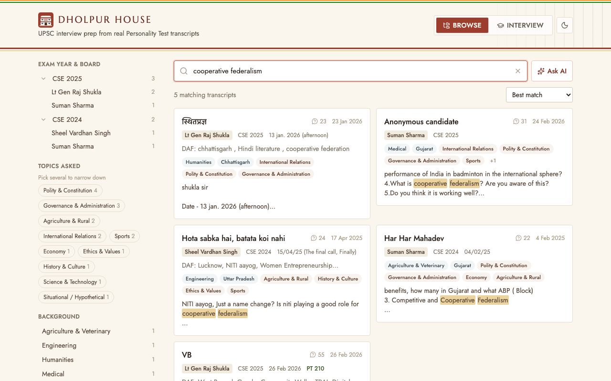
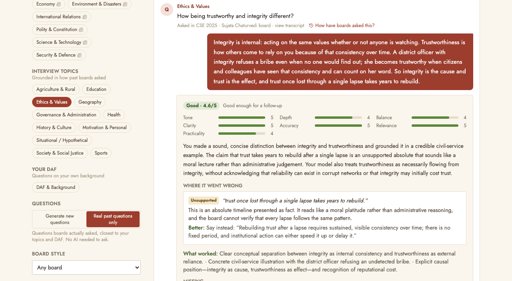

# Dholpur House

[](LICENSE) [](https://github.com/abhinaymaddha/dholpur-house/actions/workflows/ci.yml)

**Prepare for the UPSC Civil Services interview with real Personality Test transcripts.**
Search what boards actually asked, ask questions about it, and practise with an AI interview board that
questions you, listens, and critiques your answers.

**Try it: [dholpurhouse.in](https://dholpurhouse.in)**



## What you can do

- **Browse.** Search every transcript by keyword, then narrow down by exam year and board, the candidate's
  background, optional subject, home state, interests, and the topics asked. Matches are highlighted, and each
  transcript opens in a clean reader that separates the Chairperson's and each member's questions.
- **Ask AI.** Ask a question such as *"What do boards ask engineers about rural postings?"* and get an answer
  drawn from the transcripts matching your search and filters, with citations you can open.
- **Interview.** Pick topics, add your DAF details, and practise with an AI board. It writes new questions from
  your background, recent news and the most similar real questions from past interviews, or asks real past
  questions only. Every answer gets a critical, specific evaluation; a good answer earns up to two follow-ups.
  Coach mode gives feedback after each answer; Exam mode saves it for a report at the end.



> Transcripts are candidates' own recollections, and AI answers and feedback can be wrong. Always check the
> sources. Dholpur House is an independent, non-commercial project, not affiliated with the UPSC or the source
> channel; see the [Disclaimer](DISCLAIMER.md).

## The transcripts and who to thank

Every transcript comes from the public Telegram channel
**[Interview Transcripts (CSPT-2026)](https://t.me/csetranscripts)** (@csetranscripts). All credit goes to the
channel's admins and to the candidates who wrote down their interviews so others could prepare. This project only
makes them searchable and claims no ownership.

Personal details are removed automatically: email addresses, phone numbers, roll numbers, Telegram usernames and
links to personal channels. The names and aliases candidates chose to share are kept, so they keep the credit.
Many wrote under pseudonyms; please don't use this project to link anyone to a real identity.

If you are an author or a channel admin and want something removed, please
[open an issue](https://github.com/abhinaymaddha/dholpur-house/issues) or contact
[@abhinaymaddha](https://github.com/abhinaymaddha) on GitHub. More in [DATA.md](DATA.md).

## Run your own copy

You need Docker with Compose, and an API key for an AI provider: OpenRouter, OpenAI, Anthropic or any
OpenAI-compatible server. A local model through Ollama needs no key.

```bash
git clone https://github.com/abhinaymaddha/dholpur-house.git && cd dholpur-house
cp backend/.env.example backend/.env        # add your provider's API key
docker compose up -d --build                # then open http://localhost:8710
```

The first start loads the transcripts that ship with the repo. That takes 10 to 15 minutes on a laptop, since
every transcript section and every question is embedded locally; the page shows a notice until it's ready.
Searching and real past questions work without any API key; Ask AI and generated interview questions need one.

**Loading a newer export.** In Telegram Desktop, open the channel → ⋮ → *Export chat history* (HTML, no media),
then run `python -m app.ingest "<export folder>"` in the backend container. On a hosted server, set
`ADMIN_TOKEN` and upload instead:
`curl -H "Authorization: Bearer $ADMIN_TOKEN" -F "files=@messages.html" https://<your-site>/api/admin/ingest`.
Each load replaces all the data.

## Choose your AI model

Which models are used is set in [`backend/models.toml`](backend/models.toml), so you can switch providers without
touching code. Each part of the app uses a named slot:

| Slot | Used for |
|---|---|
| `model_1` | Ask AI: answers from the retrieved transcripts |
| `model_2` | Interview: writing new questions |
| `model_3` | Interview: evaluating answers and choosing follow-ups |

For example, to use Claude for the evaluator, point the slot at the `anthropic` provider and set
`ANTHROPIC_API_KEY` in `backend/.env`:

```toml
[models.model_3]
provider = "anthropic"
id = "claude-opus-5-5"
reasoning_effort = "medium"
```

Providers can be `openrouter`, `openai`, `anthropic` or `openai_compatible` (Groq, Together, DeepSeek, Mistral,
Gemini's OpenAI endpoint, Ollama, vLLM, LM Studio and others). The file is re-read when it changes, so no restart
is needed. The shipped default is a free OpenRouter model: it works, but free accounts get 50 requests a day
(1,000 once you have bought $10 of credit), and the evaluator benefits most from a stronger model.

## Deploy it

The repo includes [`docker-compose.prod.yml`](docker-compose.prod.yml) for [Dokploy](https://dokploy.com) (or
any setup with Traefik). In Dokploy:

1. Create a **Compose** service from this repo with compose path `./docker-compose.prod.yml`.
2. Set the environment:
   ```
   POSTGRES_PASSWORD=<long random string>
   OPENROUTER_API_KEY=<key>                # or OPENAI_API_KEY / ANTHROPIC_API_KEY, to match models.toml
   ADMIN_TOKEN=<long random string>        # optional: enables uploading a new export
   RATE_PER_MINUTE=10                      # optional limits on the AI features (defaults shown):
   RATE_PER_DAY=150                        #   per visitor, per minute and per day
   AI_DAILY_BUDGET=900                     #   AI calls per day for the whole site; keep it under your provider's limit
   ```
3. Add your domain to the `frontend` service on port 80, with HTTPS.
4. Deploy. The database fills itself on first start.

Plan for about 2 GB of RAM for the embedding model and Postgres.

## How it works

```
Telegram export ──► ingest: join split messages, drop reposts and chatter, keep clearly marked transcripts,
                    read board / DAF / optional / marks, tag topics, redact personal details,
                    split into member sections and individual questions, embed them locally
                ──► Postgres + pgvector: transcripts, sections and every question asked, each searchable
                    by keyword and by meaning
                ──► FastAPI ──► React app: Browse · Ask AI · Interview
```

- **Ask AI** ranks transcript sections two ways, by meaning (vector similarity) and by keywords (full-text
  search), merges the rankings, and gives the best sections of the top transcripts to the model, which must cite
  them.
- **Interview questions** are written from the topic's guidance, your DAF, the chosen board's style, recent news
  for current-affairs topics, the real past questions closest in meaning (with what the board asked next), and the
  full interviews of candidates whose profile is most like yours.
- **Evaluation** is meant to be strict but fair, and must not invent facts. Every criticism must quote your own
  words, and code checks remove any quote that isn't in your answer and any recent date or figure that isn't in
  the question, your answer or the news item. The rules for follow-ups live in code, not in the prompt: only an
  answer scoring at least 3 on every dimension and 3.5 on average earns one, and a question gets at most two.
- **Embeddings** are computed locally with [fastembed](https://github.com/qdrant/fastembed)
  (`paraphrase-multilingual-MiniLM-L12-v2`, which also handles Hindi), so only the AI features need an API key.

## Contributing

Bug reports, better prompts, new interview topics and fixes are all welcome. [CONTRIBUTING.md](CONTRIBUTING.md)
covers setting up a development environment, running the tests, how the code is organised, and how to measure
prompt changes. Found a security problem? Please report it privately, as described in [SECURITY.md](SECURITY.md).

## License

The code, prompts and documentation are licensed under [CC BY-NC 4.0](LICENSE): free to use, share and adapt
for non-commercial purposes, with credit. **Commercial use needs permission**:
[open an issue](https://github.com/abhinaymaddha/dholpur-house/issues) or contact
[@abhinaymaddha](https://github.com/abhinaymaddha) on GitHub.

The transcripts are not covered by this license. They belong to their authors; see [DATA.md](DATA.md).
